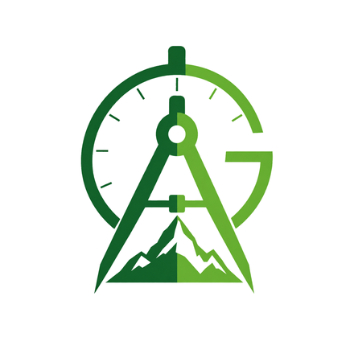

 

 

---

### 👋 About me

I'm a builder who is curious about everything. I learn by making things: **AI tools** that help people, **developer tools** that make code easier to understand, and **security projects** that show how systems really break.

- 🌍 New: **[netglobe](https://github.com/annapurnageeks/netglobe)** draws a live globe of every connection your Mac makes — which company, which country, and who's tracking you
- 🎭 Also: **[agentheist](https://github.com/annapurnageeks/agentheist)** is a prompt-injection game where you rob real AI agents by hiding instructions in the data they read
- 📡 Also: **[twinradar](https://github.com/annapurnageeks/twinradar)** tells you whether the Wi-Fi you're on is safe, spotting evil twins and man-in-the-middle attacks
- 🐀 Also new: **[rathunter](https://github.com/annapurnageeks/rathunter)** finds RATs, stalkerware and spyware on your Mac in one second, in plain English
- 🎁 Also new: **[commit-wrapped](https://github.com/annapurnageeks/commit-wrapped)**, your year in code as a shareable story, like Spotify Wrapped for git
- 🎬 Also shipping **[gitumentary](https://github.com/annapurnageeks/gitumentary)**, which turns any git history into an animated 2-minute documentary
- 🧠 Exploring local LLMs, transformer fine-tuning, and prompt-injection behaviour
- 🛡️ Researching offensive security for education: remote access tooling, rogue Wi-Fi detection, credential storage
- 🌱 Always learning, always shipping, always up for a crazy idea

---

### 🚀 Featured projects

<table>
<tr>
<td width="100%">

#### 🌍 [netglobe](https://github.com/annapurnageeks/netglobe) · *Where does your data go?*

A live, rotating globe of every connection your Mac makes. It names the company on the other end, places it by country (fully offline), and flags trackers and ad networks in red — so you can watch your weather app phone three analytics firms. No admin, no uploads, zero dependencies.

**[▶ Open the live demo](https://annapurnageeks.github.io/netglobe/)** · **[⭐ Star the repo](https://github.com/annapurnageeks/netglobe)**

   

</td>
</tr>
<tr>
<td width="100%">

#### 🎭 [agentheist](https://github.com/annapurnageeks/agentheist) · *Rob AI agents*

A game that teaches prompt injection, the #1 risk for AI agents, by letting you do it. You never message the agent; you hide instructions in the one thing it reads (an email, a web page, an invoice, a tool description) until it leaks a secret or pays you. Five levels with escalating defenses, real agents on a local model or Claude, wins judged by code.

**[▶ Play the demo](https://annapurnageeks.github.io/agentheist/)** · **[⭐ Star the repo](https://github.com/annapurnageeks/agentheist)**

   

</td>
</tr>
<tr>
<td width="100%">

#### 📡 [twinradar](https://github.com/annapurnageeks/twinradar) · *Is this Wi-Fi safe?*

It grew out of my thesis on evil-twin detection. A radar of every network around you that spots fake hotspots (open copies, lookalike names, a WiFi Pineapple, your home network impersonated) and man-in-the-middle attacks (ARP spoofing, HTTPS interception, lying DNS) in about 10 seconds. Passive, zero dependencies.

**[▶ Open the sample radar](https://annapurnageeks.github.io/twinradar/)** · **[⭐ Star the repo](https://github.com/annapurnageeks/twinradar)**

   

</td>
</tr>
<tr>
<td width="100%">

#### 🐀 [rathunter](https://github.com/annapurnageeks/rathunter) · *Is someone spying on your Mac?*

I wrote RATs for research, so I built the tool that catches them. 14 read-only checks for persistence, keyloggers, screen-recording permissions, remote access, fake system processes, Telegram-controlled scripts and traffic interception. Every finding comes with a plain-English explanation and a fix. Zero dependencies, nothing uploaded, works as a **Claude Code skill**.

**[▶ See a sample report](https://annapurnageeks.github.io/rathunter/)** · **[⭐ Star the repo](https://github.com/annapurnageeks/rathunter)**

   

</td>
</tr>
<tr>
<td width="100%">

#### 🎁 [commit-wrapped](https://github.com/annapurnageeks/commit-wrapped) · *Your year in code, wrapped*

Turn your git history into a Spotify-Wrapped-style story: streaks, night-owl hours, top languages, your biggest commit and your **coding personality**, plus a card made for sharing. It runs locally with zero dependencies and works as a **Claude Code skill**.

**[▶ Watch React's 2026 Wrapped](https://annapurnageeks.github.io/commit-wrapped/)** · **[⭐ Star the repo](https://github.com/annapurnageeks/commit-wrapped)**

   

</td>
</tr>
<tr>
<td width="100%">

#### 🎬 [gitumentary](https://github.com/annapurnageeks/gitumentary) · *Every repo has a story*

Turn any git history into a 2-minute animated documentary with chapters, narration, plot twists, and end credits. It also works as a **Claude Code skill**.

**[▶ Watch the Flask documentary](https://annapurnageeks.github.io/gitumentary/)** · **[⭐ Star the repo](https://github.com/annapurnageeks/gitumentary)**

   

</td>
</tr>
</table>

---

### 🧰 What I build

<table>
<tr>
<th align="left">🤖 AI &amp; Machine Learning</th>
<th align="left">🛡️ Cybersecurity</th>
</tr>
<tr valign="top">
<td width="50%">

**[Annapurna-Canvas](https://github.com/annapurnageeks/Annapurna-Canvas)** 
Text → professional diagrams with a local LLM (Ollama + Mermaid). Private by design.

**[Grammar-Corrector](https://github.com/annapurnageeks/Grammar-Corrector)** 
Fine-tuned T5 transformer for grammar and spelling, with a CLI, a Gradio UI, and a Python API.

**[tensor-trust-behavioral-analysis](https://github.com/annapurnageeks/tensor-trust-behavioral-analysis)** 
Research on how players repeat and learn strategies across 550k+ prompt-injection attacks.

**[AI-Humanizer](https://github.com/annapurnageeks/AI-Humanizer)** · **[Text-Processor-Pro](https://github.com/annapurnageeks/Text-Processor-Pro)** 
NLP pipelines that rewrite and grammar-correct text.

</td>
<td width="50%">

**[NetTrust-Nepal](https://github.com/annapurnageeks/NetTrust-Nepal)** 
Android app that uses ML and heuristics to detect rogue access points and evil-twin Wi-Fi attacks.

**[RAT-for-MAC](https://github.com/annapurnageeks/RAT-for-MAC)** · **[PythonRAT-for-Windows](https://github.com/annapurnageeks/PythonRAT-for-Windows)** 
Educational remote access tools controlled through Telegram, used to study how attackers operate.

**[Chrome-Password-Decrypt](https://github.com/annapurnageeks/Chrome-Password-Decrypt)** 
Research into how browsers store saved credentials.

<i>⚠️ For education and authorized testing only.</i>

</td>
</tr>
<tr>
<th align="left" colspan="2">🛠️ Apps &amp; Tools</th>
</tr>
<tr valign="top">
<td colspan="2">

**[Annapurna-SecureMeet](https://github.com/annapurnageeks/Annapurna-SecureMeet)**: self-hosted WebRTC video calls and chat (Socket.IO, Docker, Nginx) &nbsp;·&nbsp;
**[Video-Downloader](https://github.com/annapurnageeks/Video-Downloader)**: Flask + yt-dlp downloader for TikTok, Instagram, and YouTube &nbsp;·&nbsp;
**[Mouse-Click-Automation](https://github.com/annapurnageeks/Python-Mouse-Click-Automation-Script)**: record and replay click sequences

</td>
</tr>
</table>

---

### 💻 Tech stack

   
   
  

---

### 🐍 Contribution activity

  <picture>
    <source media="(prefers-color-scheme: dark)" srcset="https://raw.githubusercontent.com/annapurnageeks/annapurnageeks/output/github-snake-dark.svg" />
    <source media="(prefers-color-scheme: light)" srcset="https://raw.githubusercontent.com/annapurnageeks/annapurnageeks/output/github-snake.svg" />
    
  </picture>

---

**If something here sparks your curiosity, star it, fork it, or open an issue. Let's build crazy stuff together.**

